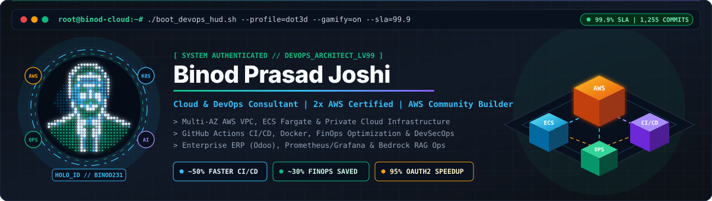
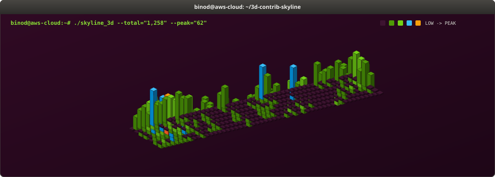

<div align="center">
  
</div>

<p align="center">
  <a href="https://binodprasadjoshi.com.np">
    
  </a>
</p>

<p align="center">
  <a href="https://binodprasadjoshi.com.np">
    
  </a>
  <a href="https://www.linkedin.com/in/binod-prasad-joshi-549067281">
    
  </a>
  <a href="https://www.credly.com/badges/4fe1dc98-121e-41ed-a1b1-0d611ef6b6ac/public_url">
    
  </a>
  <a href="mailto:joshibinodprasad77@gmail.com">
    
  </a>
  <a href="https://drive.google.com/file/d/1QdJ0GqlDd9ft0moKAfKePkIh_cKaUklA/view?usp=sharing">
    
  </a>
  
</p>

---

### `root@binod-cloud:~# neofetch --operator --rpg`

<table>
  <tr>
    <td width="230" align="center" valign="middle">
      
      <br/><br/>
      <code>[ UID: Binod231 // ONLINE ]</code><br/>
      <code>[ LOC: Pokhara, NP (UTC+5:45) ]</code>
    </td>
    <td valign="top">

```yaml
OPERATOR      : Binod Prasad Joshi
CLASS         : Cloud & DevOps Architect [LV. 99]
GUILD         : Glovion Consulting Private Limited
XP_BAR        : [########################--] 92% -> Principal Track
RECOGNITIONS  : AWS Community Builder (Dev Tools 2026) | Google Student Ambassador
UPTIME_SHIELD : 99.9% SLA Multi-AZ & Multi-Data Center Operations
SPEED_BUFF    : ~50% Faster CI/CD | 95% OAuth2 Latency Reduction
FINOPS_BUFF   : ~30% Monthly AWS Cost Cut via Compute & DB Optimization
SECURITY_BUFF : Shift-Left SAST | Least-Privilege IAM | AWS WAF & Backup

ACTIVE_LOADOUT:
  cloud       : [AWS EC2, ECS Fargate, RDS, S3, SAM, CloudFormation, Route53, WAF, Bedrock]
  devops      : [GitHub Actions, Docker, Compose, Nginx, Linux (Ubuntu/Debian), Bash]
  observability: [Prometheus, Grafana, CloudWatch, X-Ray, Multi-DC Node Exporter, Odoo Ops]
  backend_ai  : [Python, FastAPI, Django, Flask, PostgreSQL, Redis, pgvector, ChromaDB]
```

    </td>
  </tr>
</table>

---

### `root@binod-cloud:~# ./devops_defender.sh --play --live-grid`

> Real-time gamified **DevOps Defender** terminal arcade running across my live GitHub contribution matrix — neutralizing `[CVE]`, `[502]`, `[OOM]`, and `[LAG]` threats in production.

<div align="center">
  
</div>

---

### `root@binod-cloud:~# ./skyline_3d.sh --render --isometric`

> 365-day contribution topology rendered as a **3D Isometric Cyber Skyline** directly from live GitHub activity (auto-synced daily via GitHub Actions).

<div align="center">
  
</div>

---

### `root@binod-cloud:~# ./missions.sh --interactive --unlock-logs`

> Click any mission command below to inspect production architecture, challenges solved, and unlocked system rewards.

<details>
<summary><b>[MISSION_01] Glovion Consulting — Enterprise ERP (Odoo) &amp; Multi-DC Ops</b> — <code>REWARD: 99.9% ERP Uptime</code></summary>
<br/>

```bash
$ ./deploy_erp.sh --target=private-cloud --monitor=multi-dc
> Tuning Odoo cron workers & PostgreSQL memory allocations........... [OK]
> Deploying isolated Docker templates behind Nginx reverse proxy....... [OK]
> Attaching Prometheus + Grafana telemetry across remote data centers.. [OK]
> Scheduling automated DB dumps + filestore DR synchronization......... [OK]
```

</details>

<details>
<summary><b>[MISSION_02] One Cloud Utopia — Multi-App AWS Modernization (4 Prod Apps)</b> — <code>REWARD: -30% AWS Bill | ~50% Faster CI/CD</code></summary>
<br/>

```bash
$ ./modernize_fleet.sh --apps="Zyrona,Outfitmirror,MCQtest,Princika"
> [MCQtest]      Provisioned 12-stack CloudFormation Multi-AZ ECS Fargate + WAF...... [OK]
> [Outfitmirror] Built serverless AWS SAM + Bedrock Nova Canvas async VTO pipeline..... [OK]
> [Zyrona]       Replaced OpenSearch with tuned PostgreSQL queries (-30% spend)........ [OK]
> [Princika]     Standardized Docker Compose + Alembic migrations in GitHub Actions.... [OK]
```

</details>

<details>
<summary><b>[MISSION_03] Karnovation Inc — AWS Pathway EdTech &amp; High-Concurrency Auth</b> — <code>REWARD: +95% OAuth2 Speedup</code></summary>
<br/>

```bash
$ ./scale_edtech.sh --concurrency=enterprise
> Implementing Redis JWKS caching (-95% OAuth2 latency, zero downtime).. [OK]
> Engineering async FastAPI + SQLAlchemy exam engine (<100ms API)........ [OK]
> Automating 1,000+ B2B enterprise user provisioning & RBAC workflows.... [OK]
> Executing 39+ zero-downtime Alembic schema migrations.................. [OK]
```

</details>

<details>
<summary><b>[MISSION_04] Sabudh Foundation — Production LLM &amp; Grounded RAG Pipelines</b> — <code>REWARD: -70% Manual Review</code></summary>
<br/>

```bash
$ ./run_rag_agents.sh --pipeline=multi-agent
> Parsing & chunking unstructured PDF/Docx streams into vector store.... [OK]
> Grounding LLM responses via semantic RAG search (eliminated drift).... [OK]
> Orchestrating LangGraph multi-agent summarization & sentiment nodes.... [OK]
```

</details>

<details>
<summary><b>[MISSION_05] Open Source Armory — Security, AI &amp; SaaS Repositories</b> — <code>STATUS: DEPLOYED</code></summary>
<br/>

| Codename | Domain | Highlights | Repository |
| :--- | :--- | :--- | :--- |
| **API Analyzer (SAST)** | Shift-Left Security | Stateful AST taint analysis for Flask/Django/FastAPI + Dockerfile scanning | [Repo](https://github.com/Binod231/cloudnative-api-security-analyzer) |
| **EDURIDE SaaS** | Multi-Tenant Cloud | Real-time GPS ingestion, RBAC tenant isolation, Docker on AWS EC2 | [Repo](https://github.com/Binod231/School_Bus_Management_System) |
| **RAG API (FastAPI)** | Local AI Ops | FastAPI + Ollama + ChromaDB + TinyLlama local retrieval pipeline | [Docs](https://learn.nextwork.org/nostalgic_pink_clever_cherimoya/docs/ai-devops-api) |
| **Stores REST API** | Backend & Cache | JWT auth with Redis token revocation, Swagger docs, Dockerized | [Repo](https://github.com/Binod231/rest-api-project) |

</details>

<details>
<summary><b>[LOGS] AWS Builder Center Publications — 7 Technical Deep-Dives</b> — <code>AUTHOR: @Binod231</code></summary>
<br/>

- [The Agentic AI Era on AWS: Production-Ready Agents with Bedrock AgentCore](https://builder.aws.com/content/3JFung63VfYEKbYHIUuaJWred3l/the-agentic-ai-era-on-aws-whats-trending-in-2026-and-how-to-build-production-ready-agents)
- [Your AI Agent Has God-Mode IAM: Fail-Closed Proxy for Least-Privilege AI](https://builder.aws.com/content/3IwFRy6vy2DF9gviMgbX1J3uqrq/your-ai-agent-has-god-mode-iam-heres-the-proxy-i-built-to-take-it-away)
- [The Digital Fast-Pass: Low-Latency Global Apps with Route 53, CloudFront &amp; Global Accelerator](https://builder.aws.com/content/3IGUEDK1H3yBfsV4W9XvVsCNZpA/the-digital-fast-pass-building-a-low-latency-global-application-on-aws)
- [Ephemeral AI Code Sandboxes with AWS Lambda MicroVMs &amp; Firecracker](https://builder.aws.com/content/3Hth5GJ7ehZ6rJnmRaEiEWegoaO/i-gave-ai-its-own-aws-machine-then-destroyed-it)
- [Petabyte AI Pipelines: Apache Pig on EMR (Graviton) + Amazon Bedrock](https://builder.aws.com/content/3HXH38b8XDsPBealUK4SfPygwLI/petabyte-ai-pipelines-apache-pig-meets-amazon-bedrock)
- [Everyone Wanted Spark. We Kept Apache Pig on EMR and Cut Costs by 33%](https://builder.aws.com/content/3HJnLkHKc3wjIuL5kDYLi1mO58p/everyone-wanted-spark-we-kept-apache-pig-and-won-anyway)
- [Automated PR Reviews with Amazon Bedrock, CodeBuild &amp; AWS CDK](https://builder.aws.com/content/3HCa4ZqPprwVZM7mfDRBIdrjRNC/stop-reviewing-prs-let-aws-bedrock-do-it)

</details>

---

### `root@binod-cloud:~# ./verify_certs.sh --all`

| Status | Credential | Issuer | Valid / Info |
| :---: | :--- | :--- | :---: |
| `[PASS]` | **[AWS Certified Solutions Architect – Associate (SAA-C03)](https://www.credly.com/badges/4fe1dc98-121e-41ed-a1b1-0d611ef6b6ac/public_url)** | Amazon Web Services | Jan 2029 |
| `[PASS]` | **[AWS Certified Cloud Practitioner (CLF-C02)](https://www.credly.com/badges/f31fbcf5-1fdc-4f17-9f1b-41d7a1973d5c/linked_in_profile)** | Amazon Web Services | Oct 2028 |
| `[PASS]` | **AWS Community Builder — Dev Tools** | Amazon Web Services | 2026 |
| `[PASS]` | **Google Student Ambassador** | Google | 2026 |
| `[PASS]` | **[AWS Cloud Quest: Cloud Practitioner &amp; Serverless Developer](https://www.credly.com/badges/fab8bca5-d14d-4327-a2d6-8cff3e8e205a/public_url)** | Amazon Web Services | Verified |
| `[PASS]` | **[NPTEL Elite + Silver Award — Cloud Computing &amp; ML](https://drive.google.com/file/d/1PLmbxr-GYJdqlXvptDIMHc2d7Xa9_DVz/view?usp=drive_link)** | IIT Madras / NPTEL | Verified |
| `[PASS]` | **[Top SQL 50 Badge](https://leetcode.com/u/Binod124/)** | LeetCode | Verified |

---

### `root@binod-cloud:~# htop --github-telemetry`

<div align="center">
  
  
</div>

<br/>

<div align="center">
  
</div>

<br/>

<div align="center">
  
</div>

---

<p align="center">
  
</p>

```text
[EOF] // systems don't lie. logs don't lie. ship -> measure -> optimize -> automate.
```
