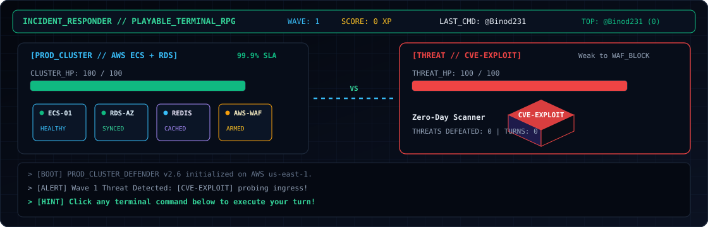

<div align="center">
  
</div>

<p align="center">
  <a href="https://binodprasadjoshi.com.np">
    
  </a>
</p>

<p align="center">
  <a href="https://binodprasadjoshi.com.np">
    
  </a>
  <a href="https://www.linkedin.com/in/binod-prasad-joshi-549067281">
    
  </a>
  <a href="https://www.credly.com/badges/4fe1dc98-121e-41ed-a1b1-0d611ef6b6ac/public_url">
    
  </a>
  <a href="mailto:joshibinodprasad77@gmail.com">
    
  </a>
  <a href="https://drive.google.com/file/d/1QdJ0GqlDd9ft0moKAfKePkIh_cKaUklA/view?usp=sharing">
    
  </a>
  
</p>

---

```bash
root@binod-cloud:~# neofetch --operator --gamify
```

<table>
  <tr>
    <td width="225" align="center" valign="middle">
      
      <br/><br/>
      <code>[ TTY1 :: AUTHENTICATED ]</code><br/>
      <code>[ LOC  :: Pokhara, NP   ]</code><br/>
      <code>[ ZONE :: UTC+5:45      ]</code>
    </td>
    <td valign="top">

```yaml
OPERATOR      : Binod Prasad Joshi
CLASS         : Cloud & DevOps Architect [LV. 99]
GUILD         : Glovion Consulting Private Limited
RANK_XP       : [########################--] 92% -> Principal Track
CLEARANCE     : 2x AWS Certified | AWS Community Builder (Dev Tools 2026)
AMBASSADOR    : Google Student Ambassador (2026)
SHIELD_SLA    : 99.9% Uptime Across Multi-AZ AWS & Multi-DC Fleet
SPEED_BUFF    : ~50% Faster CI/CD | -95% OAuth2 Latency (Zero Downtime)
FINOPS_BUFF   : -30% Monthly AWS Bill via Compute & PostgreSQL Tuning
SEC_POSTURE   : Shift-Left SAST | Least-Privilege IAM | AWS WAF & Backup
```

    </td>
  </tr>
</table>

---

```bash
root@binod-cloud:~# ./incident_responder.sh --interactive --multiplayer
# [PLAYABLE GAME] Click any terminal command below -> click "Submit new issue" -> wait ~15s & refresh!
```

<div align="center">
  
</div>

<p align="center">
  <a href="https://github.com/Binod231/Binod231/issues/new?title=GAME%3AWAF_BLOCK&body=Just+click+Create+to+execute+.%2Fwaf_block.sh+against+the+active+threat!">
    
  </a>
  <a href="https://github.com/Binod231/Binod231/issues/new?title=GAME%3ASCALE_ECS&body=Just+click+Create+to+execute+.%2Fscale_ecs.sh+and+autoscale+Fargate!">
    
  </a>
  <a href="https://github.com/Binod231/Binod231/issues/new?title=GAME%3AFLUSH_REDIS&body=Just+click+Create+to+execute+.%2Fflush_redis.sh+and+heal+cluster+SLA!">
    
  </a>
  <a href="https://github.com/Binod231/Binod231/issues/new?title=GAME%3ACANARY_DEPLOY&body=Just+click+Create+to+execute+.%2Fcanary_deploy.sh+for+critical+damage!">
    
  </a>
  <a href="https://github.com/Binod231/Binod231/issues/new?title=GAME%3ARESET&body=Just+click+Create+to+reboot+the+cluster+defense+game!">
    
  </a>
</p>

```bash
root@binod-cloud:~# ./devops_defender.sh --mode=arcade --grid=live
# [INFO] Live automated contribution defender across 1,250+ commit nodes.
```

<div align="center">
  
</div>

---

```bash
root@binod-cloud:~# ./skyline_3d.sh --render --topology=isometric --days=365
# [INFO] Compiling 365-day contribution matrix into 3D isometric skyline...
```

<div align="center">
  
</div>

---

```bash
root@binod-cloud:~# ./stackctl --inspect --verbose
```

```text
+-----------------------------------------------------------------------------+
|  [01] CLOUD & INFRASTRUCTURE                                                |
|  AWS (EC2, ECS Fargate, RDS Multi-AZ, S3, SAM, CloudFormation, Route53,     |
|       WAF, IAM, CloudWatch, X-Ray, Bedrock) | Private Cloud | Multi-DC      |
+-----------------------------------------------------------------------------+
|  [02] DEVOPS, CI/CD & CONTAINERS                                            |
|  GitHub Actions | Docker | Docker Compose | Nginx | Linux (Ubuntu/Debian)   |
|  Bash | Alembic Zero-Downtime Migrations | ASG Rolling Refreshes            |
+-----------------------------------------------------------------------------+
|  [03] OBSERVABILITY & PRODUCTION OPS                                        |
|  Prometheus | Grafana | Node Exporter | Enterprise ERP (Odoo) Ops           |
|  Automated Disaster Recovery & Multi-Location Filestore Sync                |
+-----------------------------------------------------------------------------+
|  [04] BACKEND, DATA & AI INFRASTRUCTURE                                     |
|  Python | FastAPI | Django | Flask | Async SQLAlchemy | OAuth2 / JWT        |
|  PostgreSQL | MySQL | Redis | pgvector | ChromaDB | RAG | Multi-Agent LLM   |
+-----------------------------------------------------------------------------+
```

---

```bash
root@binod-cloud:~# ./missionctl --list-all --interactive
# [HINT] Click any command below to tail production execution logs & loot.
```

<details>
<summary><code>$ ./missionctl logs --id=01 --org="Glovion Consulting" --status="ACTIVE"</code></summary>

```diff
+ [MISSION_01] Enterprise ERP (Odoo), Private Cloud & Multi-Data Center Ops
+ [TIMELINE  ] Oct 2026 - Present | Private Cloud & Multi-DC
+ ---------------------------------------------------------------------------
+ > Tuned Odoo worker pools & PostgreSQL memory for 99.9% ERP uptime
+ > Containerized & deployed internal services onto dedicated private cloud
+ > Hardened legacy physical/virtual hosts (kernel patching, disk & RAM audits)
+ > Unified remote data centers under Prometheus + Grafana telemetry panes
+ > Automated scheduled DB dumps & multi-location filestore DR pipelines
```

</details>

<details>
<summary><code>$ ./missionctl logs --id=02 --org="One Cloud Utopia" --reward="-30% AWS_BILL"</code></summary>

```diff
+ [MISSION_02] Multi-App Cloud Modernization (Zyrona, Outfitmirror, MCQtest, Princika)
+ [TIMELINE  ] May 2026 - Jun 2026 | Remote DevOps Consultant
+ ---------------------------------------------------------------------------
+ > [MCQtest]      12-stack CloudFormation Multi-AZ ECS Fargate + RDS + WAF
+ > [Outfitmirror] Serverless AWS SAM + Bedrock Nova Canvas async VTO pipeline
+ > [Zyrona]       Replaced OpenSearch with tuned PostgreSQL (-30% AWS spend)
+ > [Princika]     Docker Compose + Nginx + Alembic CI/CD (~50% faster builds)
```

</details>

<details>
<summary><code>$ ./missionctl logs --id=03 --org="Karnovation Inc" --reward="+95% OAUTH2_SPEED"</code></summary>

```diff
+ [MISSION_03] AWS Pathway Scalable EdTech Infrastructure
+ [TIMELINE  ] Sep 2025 - May 2026 | Backend / Cloud Engineer
+ ---------------------------------------------------------------------------
+ > Implemented Redis JWKS caching -> 95% OAuth2 latency drop, zero downtime
+ > Engineered async FastAPI + SQLAlchemy exam engine (<100ms core API)
+ > Automated 1,000+ enterprise B2B provisioning & RBAC workflows
+ > Executed 39+ zero-downtime Alembic schema migrations on AWS EC2 / RDS
```

</details>

<details>
<summary><code>$ ./missionctl logs --id=04 --org="Sabudh Foundation" --reward="-70% REVIEW_TIME"</code></summary>

```diff
+ [MISSION_04] Intelligent Document Analysis & Grounded RAG Pipeline
+ [TIMELINE  ] Jun 2025 - Dec 2025 | Data Science Intern
+ ---------------------------------------------------------------------------
+ > Built automated PDF/Docx ingestion, chunking & vector embedding pipeline
+ > Deployed semantic RAG search eliminating LLM hallucination in prod
+ > Orchestrated LangGraph multi-agent summarization & sentiment workflows
```

</details>

<details>
<summary><code>$ ls -la ~/armory/open-source/ && ./armory.sh --inspect</code></summary>

```bash
drwxr-xr-x  binod  devops  [SAST]  cloudnative-api-security-analyzer  # Stateful AST taint analysis + Dockerfile scanner
drwxr-xr-x  binod  devops  [SAAS]  School_Bus_Management_System       # EDURIDE multi-tenant GPS ingestion on AWS EC2
drwxr-xr-x  binod  devops  [AI  ]  ai-devops-rag-fastapi              # FastAPI + Ollama + ChromaDB + TinyLlama RAG
drwxr-xr-x  binod  devops  [API ]  rest-api-project                   # JWT + Redis token revocation + Swagger + Docker
```

- [cloudnative-api-security-analyzer](https://github.com/Binod231/cloudnative-api-security-analyzer) — Framework-aware SAST for Python (Flask/Django/FastAPI) & Dockerfiles
- [School_Bus_Management_System (EDURIDE)](https://github.com/Binod231/School_Bus_Management_System) — Multi-tenant RBAC SaaS backend with real-time GPS ingestion
- [ai-devops-api (RAG FastAPI)](https://learn.nextwork.org/nostalgic_pink_clever_cherimoya/docs/ai-devops-api) — Local RAG inference API with FastAPI & ChromaDB
- [rest-api-project (Stores API)](https://github.com/Binod231/rest-api-project) — Containerized e-commerce backend with Redis session control

</details>

<details>
<summary><code>$ curl -s https://builder.aws.com/u/Binod231 | jq '.publications'</code></summary>

```json
{
  "platform": "AWS Builder Center",
  "author": "Binod Prasad Joshi (AWS Community Builder 2026)",
  "articles_count": 7
}
```

- `[2026-09]` [The Agentic AI Era on AWS: Production-Ready Agents with Bedrock AgentCore](https://builder.aws.com/content/3JFung63VfYEKbYHIUuaJWred3l/the-agentic-ai-era-on-aws-whats-trending-in-2026-and-how-to-build-production-ready-agents)
- `[2026-09]` [Your AI Agent Has God-Mode IAM: Fail-Closed Proxy for Least-Privilege AI](https://builder.aws.com/content/3IwFRy6vy2DF9gviMgbX1J3uqrq/your-ai-agent-has-god-mode-iam-heres-the-proxy-i-built-to-take-it-away)
- `[2026-08]` [The Digital Fast-Pass: Low-Latency Global Apps with Route 53, CloudFront & Global Accelerator](https://builder.aws.com/content/3IGUEDK1H3yBfsV4W9XvVsCNZpA/the-digital-fast-pass-building-a-low-latency-global-application-on-aws)
- `[2026-08]` [Ephemeral AI Code Sandboxes with AWS Lambda MicroVMs & Firecracker](https://builder.aws.com/content/3Hth5GJ7ehZ6rJnmRaEiEWegoaO/i-gave-ai-its-own-aws-machine-then-destroyed-it)
- `[2026-08]` [Petabyte AI Pipelines: Apache Pig on EMR (Graviton) + Amazon Bedrock](https://builder.aws.com/content/3HXH38b8XDsPBealUK4SfPygwLI/petabyte-ai-pipelines-apache-pig-meets-amazon-bedrock)
- `[2026-08]` [Everyone Wanted Spark. We Kept Apache Pig on EMR and Cut Costs by 33%](https://builder.aws.com/content/3HJnLkHKc3wjIuL5kDYLi1mO58p/everyone-wanted-spark-we-kept-apache-pig-and-won-anyway)
- `[2026-07]` [Automated PR Reviews with Amazon Bedrock, CodeBuild & AWS CDK](https://builder.aws.com/content/3HCa4ZqPprwVZM7mfDRBIdrjRNC/stop-reviewing-prs-let-aws-bedrock-do-it)

</details>

---

```bash
root@binod-cloud:~# ./verify_certs.sh --credly --format=tty
```

```text
STATUS   EXPIRY      CREDENTIAL                                               ISSUER
-----------------------------------------------------------------------------------------------
[PASS]   2029-01     AWS Certified Solutions Architect - Associate (SAA-C03)    Amazon Web Services
[PASS]   2028-10     AWS Certified Cloud Practitioner (CLF-C02)               Amazon Web Services
[PASS]   2026-ON     AWS Community Builder - Dev Tools                        Amazon Web Services
[PASS]   2026-ON     Google Student Ambassador                                Google
[PASS]   VERIFIED    AWS Cloud Quest: Cloud Practitioner & Serverless Dev     Amazon Web Services
[PASS]   VERIFIED    NPTEL Elite + Silver (Cloud Computing & ML)              IIT Madras / NPTEL
[PASS]   VERIFIED    LeetCode Top SQL 50 Badge                                LeetCode
```

- Verify Live Badges: [AWS SAA-C03](https://www.credly.com/badges/4fe1dc98-121e-41ed-a1b1-0d611ef6b6ac/public_url) | [AWS CLF-C02](https://www.credly.com/badges/f31fbcf5-1fdc-4f17-9f1b-41d7a1973d5c/linked_in_profile) | [Cloud Quest Serverless](https://www.credly.com/badges/fab8bca5-d14d-4327-a2d6-8cff3e8e205a/public_url) | [NPTEL Silver](https://drive.google.com/file/d/1PLmbxr-GYJdqlXvptDIMHc2d7Xa9_DVz/view?usp=drive_link) | [LeetCode SQL 50](https://leetcode.com/u/Binod124/)

---

```bash
root@binod-cloud:~# htop --github-telemetry --user=Binod231
```

<div align="center">
  
  
</div>

<br/>

<div align="center">
  
</div>

<br/>

<div align="center">
  
</div>

---

```bash
root@binod-cloud:~# exit 0
# // systems don't lie. logs don't lie. ship -> measure -> optimize -> automate.
```
