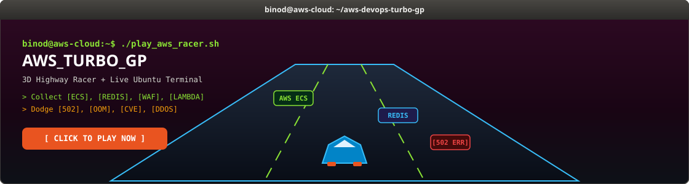

<div align="center">
  
</div>

<br/>

<p align="center">
  
</p>

<p align="center">
  <a href="https://binod231.github.io/Binod231/"></a>
  <a href="https://binod231.github.io/Binod231/"></a>
  <a href="https://binodprasadjoshi.com.np"></a>
  <a href="https://www.linkedin.com/in/binod-prasad-joshi-549067281"></a>
  <a href="https://www.credly.com/badges/4fe1dc98-121e-41ed-a1b1-0d611ef6b6ac/public_url"></a>
  <a href="https://drive.google.com/file/d/1QdJ0GqlDd9ft0moKAfKePkIh_cKaUklA/view?usp=sharing"></a>
</p>

---

```bash
binod@aws-cloud:~$ help
```

```text
COMMAND                                  DESCRIPTION
------------------------------------------------------------------------------------------
whoami --verbose                         Operator bio, certifications, location & metrics
./experience.sh --all                    Expand deep production logs across 4 companies
./projects.sh --armory                   Open-source SAST, SaaS, RAG & REST repositories
./blogs.sh --aws-builder                 7 AWS Builder Center technical deep-dive articles
./stack.sh --matrix                      Cloud, CI/CD, Observability, Backend & AI stack
./verify_certs.sh --credly               Verified AWS, Google, NPTEL & LeetCode credentials
./graphs.sh --3d --telemetry             3D Isometric skyline, stats, languages & streak
./play_aws_racer.sh --launch             Interactive Ubuntu Shell + 3D AWS DevOps Racing Game
```

> Launch the full live Ubuntu Terminal (`help`, `whoami`, `graph`, `play`) here: **[binod231.github.io/Binod231](https://binod231.github.io/Binod231/)**

---

```bash
binod@aws-cloud:~$ whoami --verbose
```

```yaml
operator      : Binod Prasad Joshi
role          : Cloud & DevOps Consultant @ Glovion Consulting Private Limited
location      : Kathmandu, Nepal (UTC+5:45 | Remote-friendly)
certifications: [AWS Solutions Architect - Associate (SAA-C03), AWS Cloud Practitioner (CLF-C02)]
recognitions  : [AWS Community Builder - Dev Tools (2026), Google Student Ambassador (2026)]
impact_summary:
  uptime_sla  : "99.9% availability across Multi-AZ AWS & Multi-Data Center infrastructure"
  cicd_speed  : "~50% faster CI/CD builds via multi-stage Docker caching"
  finops_cut  : "~30% monthly AWS spend cut via compute rightsizing & PostgreSQL tuning"
  oauth2_perf : "~95% OAuth2 latency drop via Redis JWKS caching (zero downtime)"
```

---

```bash
binod@aws-cloud:~$ ./experience.sh --all
```

<details>
<summary><code>binod@aws-cloud:~$ cat /var/log/glovion_consulting.log  # [Oct 2026 - Present | ACTIVE]</code></summary>

```diff
+ ROLE: DevOps Consultant (Private Cloud & Multi-Data Center)
+ > ERP (Odoo) Ops      : Production deployment, worker tuning & PostgreSQL optimization (99.9% uptime)
+ > Private Cloud       : Provisioned containerized internal/client services behind Nginx ingress
+ > Legacy Hardening    : Linux kernel updates, disk/RAM health audits & zero unplanned downtime
+ > Multi-DC Telemetry  : Unified remote servers under Prometheus, Node Exporter & Grafana panes
+ > Disaster Recovery   : Automated scheduled DB dumps & multi-location filestore backup pipelines
```

</details>

<details>
<summary><code>binod@aws-cloud:~$ cat /var/log/one_cloud_utopia.log    # [May 2026 - Jun 2026]</code></summary>

```diff
+ ROLE: DevOps Consultant (4 Prod Apps: Zyrona, Outfitmirror, Princika Traders, MCQtest)
+ > [MCQtest]      Architected 12-stack CloudFormation Multi-AZ ECS Fargate + RDS + Redis + AWS WAF
+ > [Outfitmirror] Built serverless AWS SAM + Amazon Bedrock Nova Canvas async VTO pipeline + Cognito
+ > [Zyrona]       ASG rolling updates + replaced OpenSearch with tuned PostgreSQL (-30% AWS spend)
+ > [Princika]     Docker Compose + Nginx + Alembic schema migrations in GitHub Actions (~50% faster builds)
```

</details>

<details>
<summary><code>binod@aws-cloud:~$ cat /var/log/karnovation_inc.log     # [Sep 2025 - May 2026]</code></summary>

```diff
+ ROLE: Backend / Cloud Engineer (AWS Pathway Scalable EdTech)
+ > OAuth2 Speedup   : Implemented Redis JWKS caching -> 95% latency drop with zero downtime
+ > Async Engine     : Built FastAPI + Async SQLAlchemy exam APIs (<100ms response) & WebSocket polls
+ > Enterprise B2B   : Automated 1,000+ account provisioning, RBAC & 39+ zero-downtime Alembic migrations
+ > AWS Hosting      : Managed EC2, S3, DynamoDB, Cognito, Amplify, IAM & Route 53 latency routing
```

</details>

<details>
<summary><code>binod@aws-cloud:~$ cat /var/log/sabudh_foundation.log   # [Jun 2025 - Dec 2025]</code></summary>

```diff
+ ROLE: Data Science Intern (LLM & Grounded RAG Infrastructure)
+ > Ingestion        : Automated parsing, chunking & embedding pipelines for PDF/Docx unstructured docs
+ > Grounded RAG     : Deployed vector search eliminating LLM hallucination in enterprise retrieval
+ > Multi-Agent Ops  : Built LangGraph summarization & sentiment agents (-70% manual review time)
```

</details>

---

```bash
binod@aws-cloud:~$ ./projects.sh --armory && ./blogs.sh --aws-builder
```

<details>
<summary><code>binod@aws-cloud:~$ ls -la ~/armory/open-source/  # Click to inspect 4 featured repositories</code></summary>

- **[API Analyzer (SAST)](https://github.com/Binod231/cloudnative-api-security-analyzer)** — Framework-aware Python SAST tool with stateful AST taint analysis (Flask/Django/FastAPI) and Dockerfile scanning.
- **[EDURIDE SaaS Backend](https://github.com/Binod231/School_Bus_Management_System)** — Multi-tenant RBAC backend with real-time GPS ingestion, containerized with Docker on AWS EC2.
- **[RAG API with FastAPI](https://learn.nextwork.org/nostalgic_pink_clever_cherimoya/docs/ai-devops-api)** — Local retrieval-augmented generation service powered by FastAPI, Ollama, ChromaDB, and TinyLlama.
- **[Stores REST API](https://github.com/Binod231/rest-api-project)** — Containerized e-commerce backend featuring JWT auth, Redis token invalidation, and Swagger docs.

</details>

<details>
<summary><code>binod@aws-cloud:~$ curl -s https://builder.aws.com/u/Binod231 | jq '.articles'  # 7 AWS Builder Posts</code></summary>

- `[2026-09]` [The Agentic AI Era on AWS: Production-Ready Agents with Bedrock AgentCore](https://builder.aws.com/content/3JFung63VfYEKbYHIUuaJWred3l/the-agentic-ai-era-on-aws-whats-trending-in-2026-and-how-to-build-production-ready-agents)
- `[2026-09]` [Your AI Agent Has God-Mode IAM: Fail-Closed Proxy for Least-Privilege AI](https://builder.aws.com/content/3IwFRy6vy2DF9gviMgbX1J3uqrq/your-ai-agent-has-god-mode-iam-heres-the-proxy-i-built-to-take-it-away)
- `[2026-08]` [The Digital Fast-Pass: Low-Latency Global Apps with Route 53, CloudFront & Global Accelerator](https://builder.aws.com/content/3IGUEDK1H3yBfsV4W9XvVsCNZpA/the-digital-fast-pass-building-a-low-latency-global-application-on-aws)
- `[2026-08]` [Ephemeral AI Code Sandboxes with AWS Lambda MicroVMs & Firecracker](https://builder.aws.com/content/3Hth5GJ7ehZ6rJnmRaEiEWegoaO/i-gave-ai-its-own-aws-machine-then-destroyed-it)
- `[2026-08]` [Petabyte AI Pipelines: Apache Pig on EMR (Graviton) + Amazon Bedrock](https://builder.aws.com/content/3HXH38b8XDsPBealUK4SfPygwLI/petabyte-ai-pipelines-apache-pig-meets-amazon-bedrock)
- `[2026-08]` [Everyone Wanted Spark. We Kept Apache Pig on EMR and Cut Costs by 33%](https://builder.aws.com/content/3HJnLkHKc3wjIuL5kDYLi1mO58p/everyone-wanted-spark-we-kept-apache-pig-and-won-anyway)
- `[2026-07]` [Automated PR Reviews with Amazon Bedrock, CodeBuild & AWS CDK](https://builder.aws.com/content/3HCa4ZqPprwVZM7mfDRBIdrjRNC/stop-reviewing-prs-let-aws-bedrock-do-it)

</details>

---

```bash
binod@aws-cloud:~$ ./stack.sh --matrix && ./verify_certs.sh --credly
```

```text
+-----------------------------------------------------------------------------+
|  CLOUD & INFRASTRUCTURE                                                     |
|  AWS (EC2, ECS Fargate, RDS Multi-AZ, S3, SAM, CloudFormation, Route53,     |
|       WAF, IAM, CloudWatch, X-Ray, Bedrock) | Private Cloud | Multi-DC      |
+-----------------------------------------------------------------------------+
|  DEVOPS, OBSERVABILITY & CONTAINERS                                         |
|  GitHub Actions | Docker | Docker Compose | Nginx | Prometheus | Grafana    |
|  Linux (Ubuntu/Debian) | Bash | Alembic | Enterprise ERP (Odoo) Ops         |
+-----------------------------------------------------------------------------+
|  BACKEND, DATA & AI INFRASTRUCTURE                                          |
|  Python | FastAPI | Django | Flask | PostgreSQL | MySQL | Redis | pgvector  |
+-----------------------------------------------------------------------------+
```

```text
STATUS   EXPIRY     CREDENTIAL                                               ISSUER
-----------------------------------------------------------------------------------------------
[PASS]   2029-01    AWS Certified Solutions Architect - Associate (SAA-C03)    Amazon Web Services
[PASS]   2028-10    AWS Certified Cloud Practitioner (CLF-C02)               Amazon Web Services
[PASS]   2026-ON    AWS Community Builder - Dev Tools                        Amazon Web Services
[PASS]   2026-ON    Google Student Ambassador                                Google
[PASS]   VERIFIED   AWS Cloud Quest: Cloud Practitioner & Serverless Dev     Amazon Web Services
[PASS]   VERIFIED   NPTEL Elite + Silver (Cloud Computing & ML)              IIT Madras / NPTEL
[PASS]   VERIFIED   LeetCode Top SQL 50 Badge                                LeetCode
```

---

```bash
binod@aws-cloud:~$ ./graphs.sh --3d --telemetry
```

<div align="center">
  
</div>

<br/>

<div align="center">
  
  
</div>

<br/>

<div align="center">
  
</div>

<br/>

<div align="center">
  
</div>

---

```bash
binod@aws-cloud:~$ ./play_aws_racer.sh --launch="https://binod231.github.io/Binod231/"
```

<div align="center">
  <a href="https://binod231.github.io/Binod231/">
    
  </a>
</div>

---

```bash
binod@aws-cloud:~$ exit 0
# Connection closed by Binod231 — systems don't lie. ship -> measure -> optimize -> automate.
```
